# Doctor Tracker

Doctor Tracker is a clinic administration app for organizing doctor profiles and patient records, with a dashboard for tracking clinic activity and patient distribution.

## Local setup

Requirements: Node.js 20 or newer, npm, and a MongoDB database.

1. Configure the backend:

   ```sh
   cp doctor-tracker-backend/.env.example doctor-tracker-backend/.env
   ```

   Set `MONGO_URI`, a private `JWT_SECRET`, and the administrator name, email, and password. The seed password must be at least 12 characters.

2. Configure the frontend:

   ```sh
   cp doctor-tracker-frontend/.env.example doctor-tracker-frontend/.env.local
   ```

   Set `BACKEND_API_URL` to the backend API URL. The default is `http://localhost:5000/api`.

3. Install and start the backend:

   ```sh
   cd doctor-tracker-backend
   npm install
   npm run seed:admin
   npm run dev
   ```

4. In another terminal, install and start the frontend:

   ```sh
   cd doctor-tracker-frontend
   npm install
   npm run dev
   ```

5. Open <http://localhost:3000> and sign in with the administrator credentials from the backend environment file.

The seed command creates the admin once and leaves an existing account unchanged. Keep `.env` and `.env.local` private; share access credentials through the submission channel when they are required.

## Architecture

The Next.js application serves the UI and a same-origin API route. That route forwards REST requests to the Express service and keeps the signed JWT in an HttpOnly cookie. The Express API validates the token and request data before reading or writing MongoDB documents.

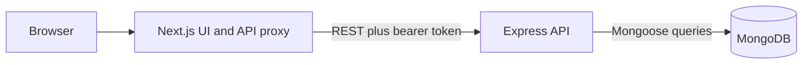

The backend owns authentication, validation, doctor and patient records, and dashboard aggregation. Mongoose models define indexes for common filters and search. The dashboard API returns totals, patient counts per doctor, daily patient intake, and condition counts.

## Technical decisions

### Same-origin API proxy and HttpOnly session cookie

The browser sends API requests to the Next.js application's `/api/*` route. The route forwards them to the Express service and stores the login JWT in an HttpOnly, same-site cookie. Keeping the token out of browser-readable storage reduces exposure to scripts running in the page, while the same-origin route avoids exposing the backend URL to client code and simplifies browser requests.

### Page-local state with server-side filtering and pagination

Search, filters, forms, and pagination state live in the page that uses them instead of a global state store. Doctor and patient searches are debounced before requests are sent, and the API returns only the requested page plus pagination metadata. This keeps state close to its UI and avoids downloading full collections just to filter them in the browser.

## Visual evidence

Screenshots are stored in `public/images/` and embedded below so they render on GitHub.

### Dashboard

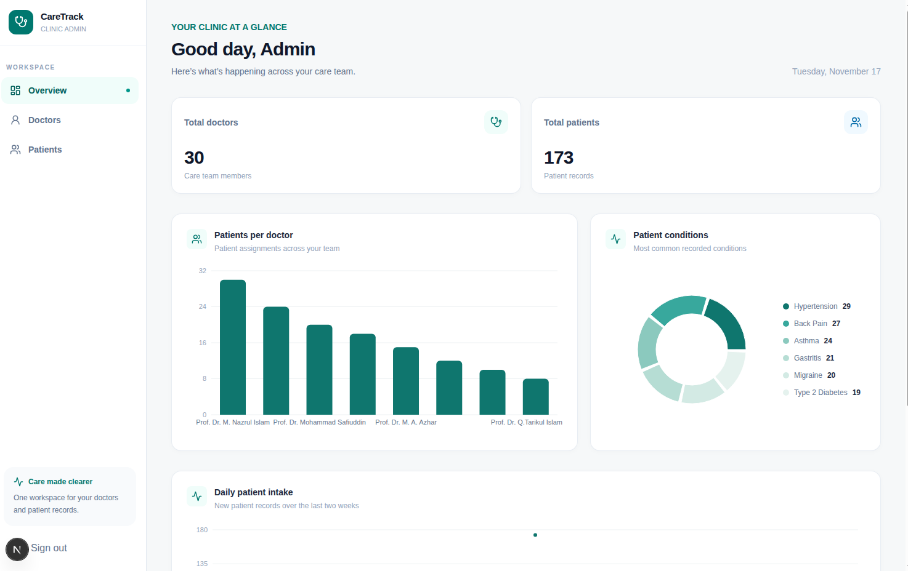

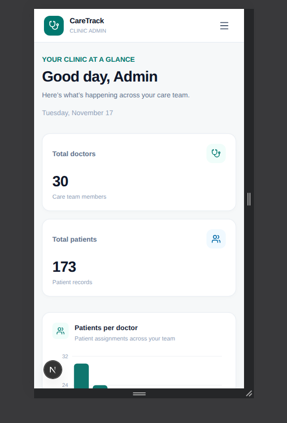

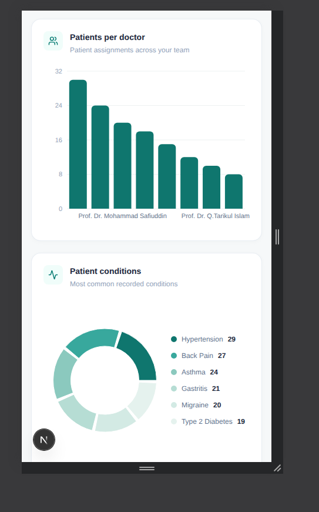

### Doctors

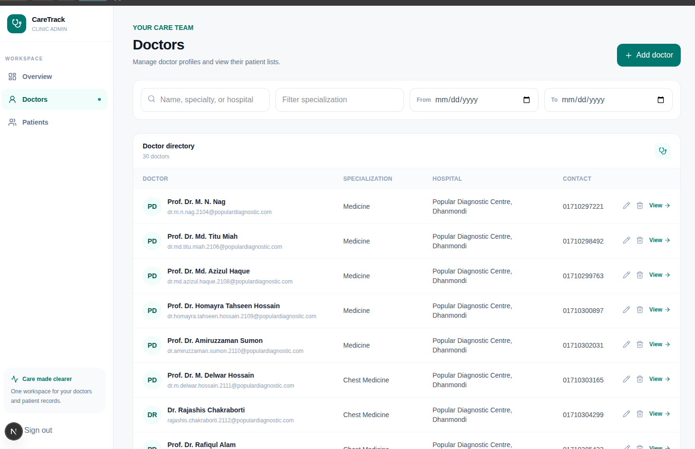

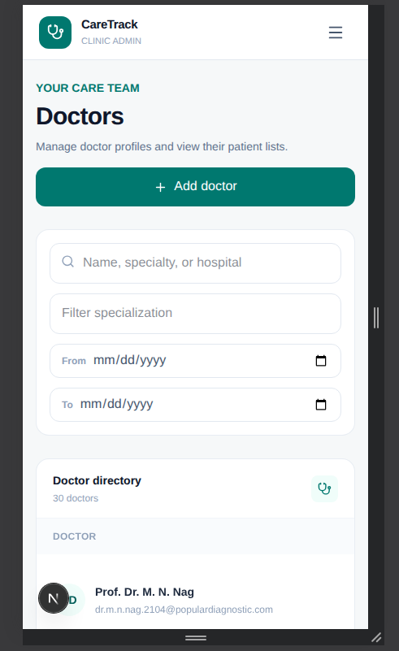

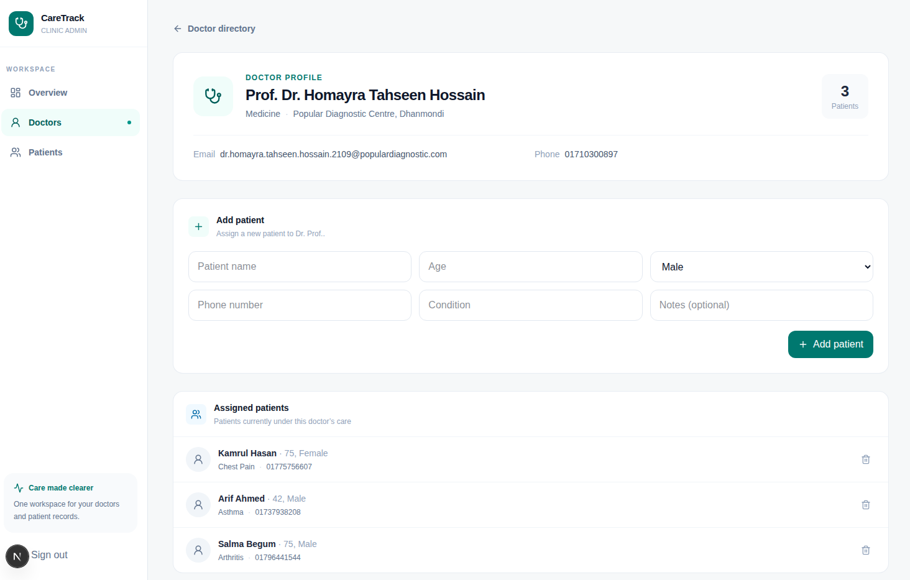

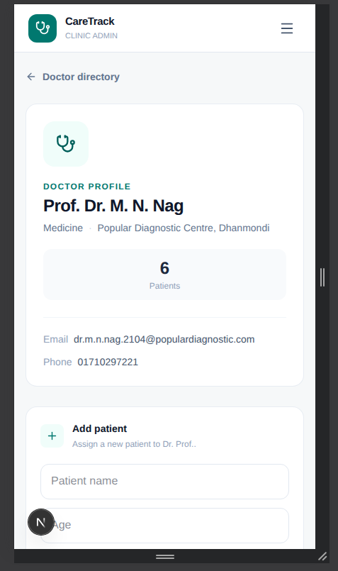

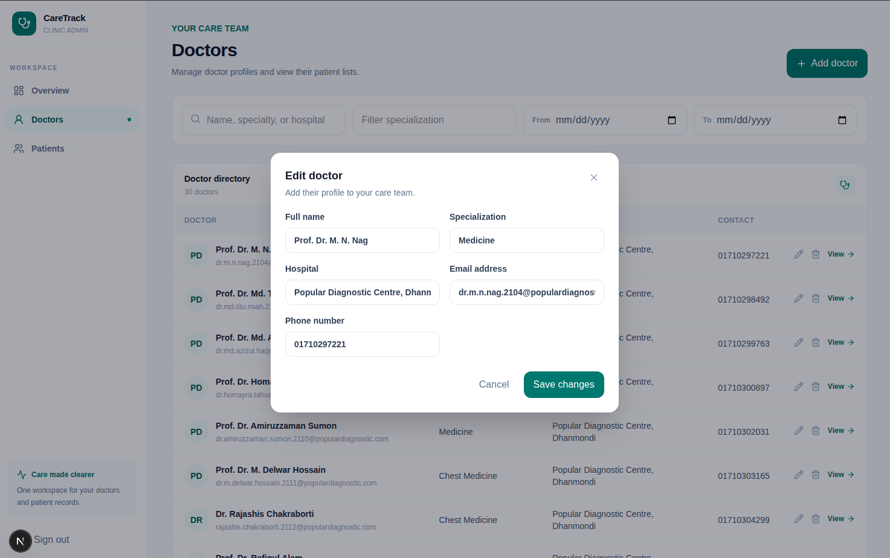

### Patients

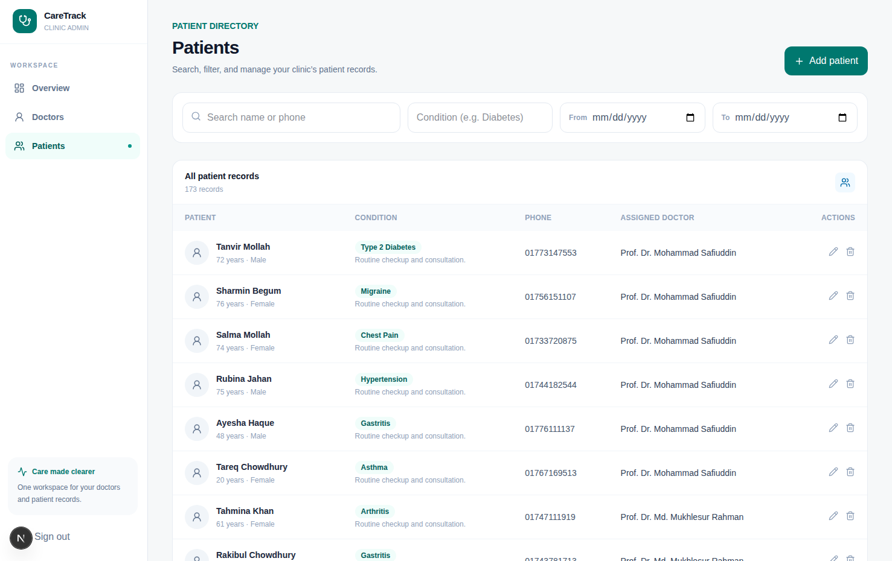

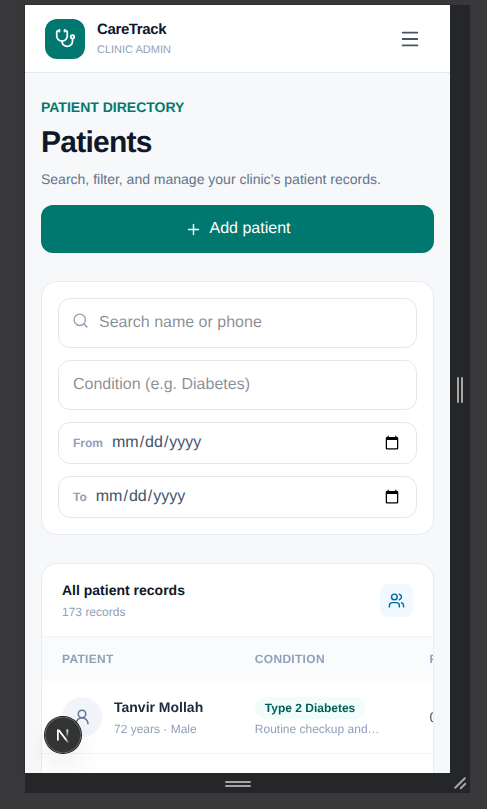

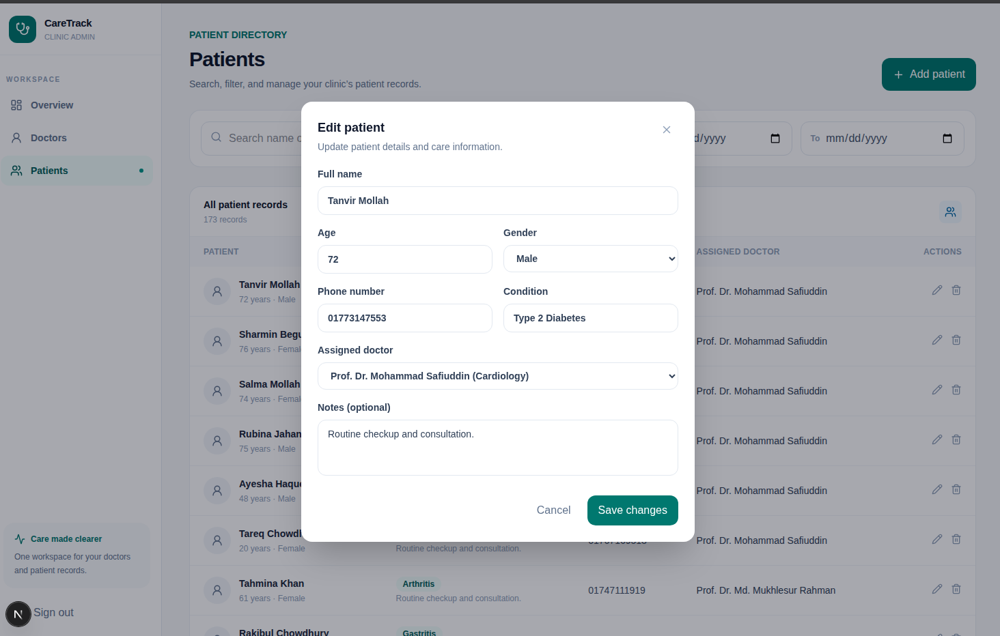

## API overview

- `POST /api/auth/login`, `GET /api/auth/me`
- `GET`, `POST /api/doctors`; `GET`, `PATCH`, `DELETE /api/doctors/:id`
- `GET`, `POST /api/patients`; `PATCH`, `DELETE /api/patients/:id`
- `GET /api/dashboard/stats`

All doctor, patient, and dashboard endpoints require an authenticated admin session.
